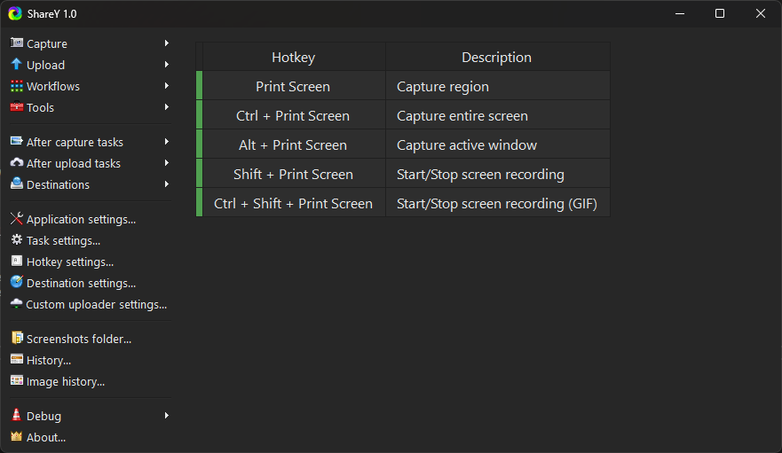

<h3 align="center">Screen capture, file sharing and productivity tool</h3>
 

## Links
* Official website: https://getsharex.com
* GitHub: https://github.com/maksw2/ShareY
* Privacy policy: https://getsharex.com/privacy-policy

## Documents
* Image effects: https://getsharex.com/image-effects
* Actions: https://getsharex.com/actions
* Dev builds: https://getsharex.com/docs/dev-builds
* Keybinds: https://getsharex.com/docs/keybinds
* Scrolling screenshot: https://getsharex.com/docs/scrolling-screenshot
* Command line arguments: https://getsharex.com/docs/command-line-arguments
* Translation: https://getsharex.com/docs/translation
* OCR: https://getsharex.com/docs/ocr
* Custom uploader: https://getsharex.com/docs/custom-uploader
* Amazon S3 guide: https://getsharex.com/docs/amazon-s3
* Google Cloud Storage guide: https://getsharex.com/docs/google-cloud-storage
* Cloudflare R2 guide: https://getsharex.com/docs/cloudflare-r2
* Brand assets: https://getsharex.com/brand-assets

## Star History
<a href="https://www.star-history.com/?repos=maksw2%2Fsharey&type=date&legend=bottom-right">
 <picture>
   <source media="(prefers-color-scheme: dark)" srcset="https://www.star-history.com/?repos=maksw2%2Fsharey&type=date&legend=bottom-right" />
   <source media="(prefers-color-scheme: light)" srcset="https://www.star-history.com/?repos=maksw2%2Fsharey&type=date&legend=bottom-right" />
   
 </picture>
</a>